# ECS 1436 — C++

My lecture notes, programming assignments, and lab exercises for ECS 1436.

## Explore

| Section | Contents |
| --- | --- |
| [Assignments & labs](assignments/) | Homework solutions, lab exercises, and supporting text files. |
| [C++ basics](cpp_lectures/cpp_basics/) | Examples covering variables, input/output, operators, control flow, functions, and arrays. |
| [Chapter 2](cpp_lectures/chapter_2/) | Chapter summary and a program split across source and header files. |
| [Chapter 3](cpp_lectures/chapter_3/) | Chapter summary examples. |
| [Lecture materials](cpp_lectures/) | C++ study PDFs, LearnCpp links, and programming style guidelines. |

## Repository Structure

```text
cpp/
├── assignments/
│   ├── assignment*.cpp
│   ├── lab*.cpp
│   ├── input.txt
│   ├── output.txt
│   └── morseLetters.txt
├── cpp_lectures/
│   ├── cpp_basics/
│   ├── chapter_2/
│   ├── chapter_3/
│   ├── ProgStyleGuidelines.pdf
│   ├── learncpp_part_1.pdf
│   ├── learn_cpp_part_2.pdf
│   └── learncpp_links.txt
├── assets/
│   └── ecs1436-banner.svg
└── README.md
```

## Compile & Run

With a C++ compiler installed, clone the repository:

```bash
git clone https://github.com/xKatzfiell/cpp.git
cd cpp
```

Compile and run an individual exercise. For example, using GCC or Clang on macOS or Linux:

```bash
cd assignments
g++ -std=c++17 -Wall -Wextra lab1.cpp -o lab1
./lab1
```

Compile each exercise separately; many files define their own `main()`. For programs that read text files, run them from the folder containing those files.

The Chapter 2 example uses two source files. Starting from the repository root:

```bash
cd cpp_lectures/chapter_2
g++ -std=c++17 -Wall -Wextra chapter2summary.cpp io.cpp -o chapter2
./chapter2
```
