# C++ Study Repository

My C++ study notes, code examples, assignments, and lab exercises.

## Explore

| Section | Contents |
| --- | --- |
| [C++ basics](cpp_lectures/cpp_basics/) | Practice with variables, input/output, operators, control flow, functions, and arrays. |
| [Chapter 2](cpp_lectures/chapter_2/) | Chapter summary and examples using source and header files. |
| [Chapter 3](cpp_lectures/chapter_3/) | Chapter summary examples. |
| [Study materials](cpp_lectures/) | Study PDFs, LearnCpp links, and programming style guidelines. |
| [Assignments & labs](assignments/) | Homework solutions, lab exercises, and supporting text files. |

## Structure

```text
cpp/
├── assignments/
│   ├── assignment*.cpp
│   ├── lab*.cpp
│   ├── input.txt
│   ├── output.txt
│   └── morseLetters.txt
├── cpp_lectures/
│   ├── cpp_basics/
│   ├── chapter_2/
│   ├── chapter_3/
│   ├── ProgStyleGuidelines.pdf
│   ├── learncpp_part_1.pdf
│   ├── learn_cpp_part_2.pdf
│   └── learncpp_links.txt
├── assets/
│   └── cpp-study-banner.svg
└── README.md
```
